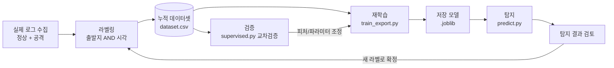

# 19. ML 모델은 어떻게 똑똑해지는가 — 학습의 의미·데이터셋·플라이휠

> 작성일: 2026-10-24 · 상태: 개념 정리(테마)
> 목적: "모델을 자꾸 저장하면 똑똑해지나?"라는 질문에 답한다. 학습의 진짜 의미, 데이터셋이 왜
> 핵심인지, 그리고 **플라이휠**(탐지 → 라벨 → 축적 → 재학습)로 성능을 올리는 원리를 한자리에.

## 0. 한 문장

> **모델의 능력은 "알고리즘 × 데이터 × 피처 × 하이퍼파라미터"로 정해진다.
> 탐지는 모델을 *쓰는* 것이고, 학습은 쌓인 라벨 데이터로 모델을 *다시 만드는* 것이다.
> 그래서 똑똑해지는 길은 "같은 걸 반복 학습"이 아니라 "데이터셋을 키워 재학습"이다.**

## 1. 가장 흔한 오해: `fit()`은 덮어쓴다, 쌓이지 않는다

scikit-learn 모델(IF·LOF·RF·Autoencoder)은 학습할 때마다 **이전 상태를 버리고 처음부터** 배운다.
`train_export.py`를 다시 돌려 저장해도 "기존 모델이 성장"한 게 아니라 **이번에 준 데이터로 만든 새 모델**이다.

```
잘못된 그림 (X)                        맞는 그림 (O)
model.fit(배치1) → 조금 똑똑          model = fit(배치1)            # 배치1만 아는 모델
model.fit(배치2) → 더 똑똑  (X)       model = fit(배치1 + 배치2)    # 둘 다 아는 모델 (데이터를 쌓아 재학습)
model.fit(배치3) → 더더 똑똑          model = fit(배치1+2+3)        # 전체로 다시
```

→ 향상의 주체는 **모델 파일이 아니라 데이터셋**이다. (온라인/증분 학습 `partial_fit`은 예외지만 이 프로젝트는 배치 재학습을 쓴다.)

## 2. 비지도 vs 지도 — 무엇으로 좋아지나

| | 비지도 (IF·LOF·AE) | 지도 (RandomForest) |
|---|---|---|
| 배우는 것 | **"정상이 어떻게 생겼나"** (정상만으로) | **"이 피처 → 이 라벨"** (정상+공격 라벨) |
| 좋아지는 법 | 정상 로그를 **대표성 있게** 확보 → 정상 경계 정교화 | **다양한 종류**의 공격 라벨 확보 → 종류 구분 |
| 한계 | 양 ≠ 향상. 편향된 정상/공격 섞인 정상은 독 | **학습에 없던 종류는 못 잡음**(본 프로젝트 E2: 0.29) |
| 역할 | **발견**(룰이 없어도 "평소와 다름") | **분류**(발견된 이상에 공격 이름 붙이기) |

> "로그만 많이 모으면 비지도 탐지율이 오른다"는 **반만 맞다**: 양이 아니라 **정상의 대표성**이 핵심이고
> 수확체감이 온다. 공격이 섞인 로그를 정상으로 학습시키면 오히려 나빠진다(라벨·정제가 중요한 이유).

## 3. 성능을 정하는 네 가지 (알고리즘은 천장의 *모양*일 뿐)

```
        피처 설계  ← 이 프로젝트의 가장 큰 지렛대
          │        (features.py: "대입=분당요청↑, BOLA=객체수↑"를 숫자로 만들어 준다)
데이터 ───┼─── 하이퍼파라미터 (contamination 등)
          │
       알고리즘 (IF/LOF/RF — 라이브러리 선택)
```

같은 RandomForest라도 **BOLA를 보는 피처(`uniq_objects`)가 없으면** BOLA를 못 잡는다.
즉 이 프로젝트의 "지능"은 sklearn 호출이 아니라 **피처 안에** 들어 있다. → 발전의 1순위는 모델 교체가 아니라 **피처 개선**.

## 4. 플라이휠 — 탐지 결과를 데이터로 되먹인다



- **탐지 ≠ 학습.** 같은 데이터로 또 탐지 = 검증·튜닝일 뿐.
- **진짜 향상** = 새 로그를 라벨링해 **누적 데이터셋에 쌓고 → 전체로 재학습**.
- 바퀴가 한 바퀴 돌 때마다: 정상 대표성↑(비지도↑), 공격 종류 다양성↑(지도↑).

## 5. 데이터셋을 "미리·잘" 만드는 법

### 5-1. 라벨을 더 명확하게
- **출발지 AND 시각 교집합**으로만 공격 라벨 (시각만으로 하면 공격 중 정상까지 오염). → `evaluate.py` 방식
- **정확한 시작/끝 UTC**를 공격마다 기록(초 단위). 창이 넓으면 정상이 섞인다.
- **요청 단위 정답(최고 정밀도)**: 공격 도구가 보내는 요청에 **표식**(예: 특정 User-Agent/헤더)을 달아
  그 표식으로 라벨링한 뒤 **표식은 피처에서 제외**(라벨 누수 방지). 완벽한 라벨을 공짜로 얻는다.
- **세부 종류 라벨**: `brute_fast`/`brute_slow`, `bola_fast`/`bola_slow`로 나누면 분류·분석이 날카로워진다.
- **다중 키**: IP 외에 계정/JWT `sub`가 있으면 함께(로그인 후 공격 귀속). 단 **IP/계정/UA 원문은 피처로 넣지 않는다**(누수).

### 5-2. 피처를 더 늘리기 (web 기준, 현재 9개 → 후보)
| 후보 피처 | 무엇을 잡나 |
|---|---|
| `status_401_403_ratio` | 인증 실패/권한 거부 → 대입·BFLA |
| `status_404_ratio` | 없는 자원 긁기 → 스캐닝·열거 |
| `seq_id_score` | 객체 ID가 **연속**인가(1,2,3…) → BOLA 열거의 전형 |
| `new_object_rate` | 새 객체 ID가 **빠르게** 늘어나는 속도 → 수집/열거 |
| `method_entropy` | 메서드 분포 → 스캐너 식별 |
| `bytes_sent_mean/max` | 응답량 → 과다 데이터 노출(Excessive Data Exposure) |
| `login_fail_count` | 로그인 실패 수 → 대입 |
| `night_ratio` | 심야 비중 → 봇/자동화 |

> 피처는 **한 번에 하나씩** 추가하고 교차검증(`supervised.py`)으로 **탐지율↑/오탐률 유지**를 확인한다.
> RF 피처 중요도(스크립트 출력)로 **쓸모없는 피처는 뺀다**(단순할수록 안정적).

### 5-3. 누적 데이터셋 규칙(플라이휠이 돌려면)
- **스키마 고정**: 열 순서·이름이 매번 같아야 쌓인다. (피처 추가 시 버전 올리고 과거분 재생성)
- **출처 열 추가**: `source`(어느 랩/날짜), `scenario`로 provenance를 남긴다(디버깅·분할용).
- **원시 로그와 분리 저장**: `data/`는 gitignore(크다). 깃엔 **스키마·스크립트·이 문서**만. 데이터는 로컬/별도 보관.

## 6. 이 프로젝트에서의 다음 바퀴

1. 실제 로그(타겟 nginx + Kali 공격) 수집 → `answer.csv`(출발지+시각)
2. `features.py --nginx` → 누적 데이터셋에 **append**
3. `supervised.py`로 검증(처음 보는 공격 탐지율·오탐률) → 피처/파라미터 조정
4. `train_export.py`로 재학습·저장 → 다음 수집 때 `predict.py`로 바로 탐지
5. 반복. 바퀴가 돌수록 정상 대표성·공격 다양성이 쌓인다.

> 관련: `docs/12`(지도 vs 비지도), `docs/13`(종합 결과), `docs/17`(검증 함정), `ml/README.md`(피처 표), `models/README.md`(모델 버전)
