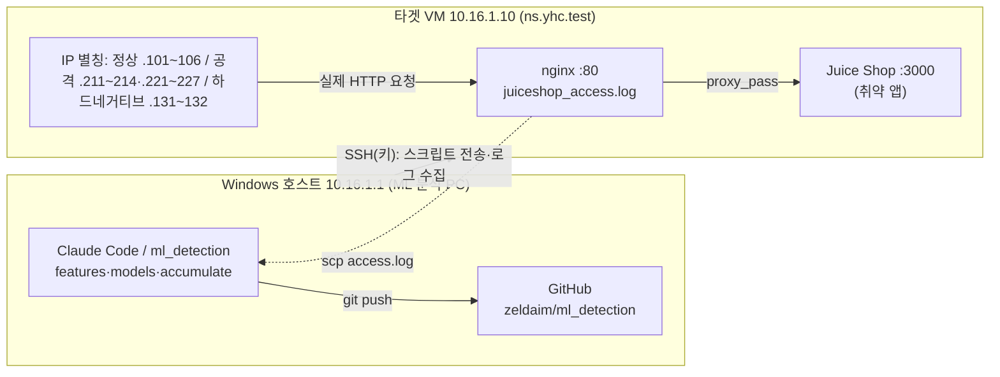
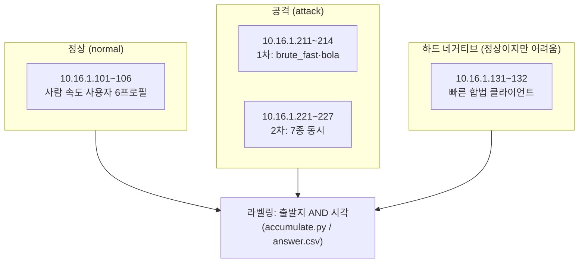
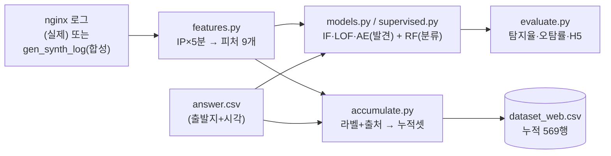
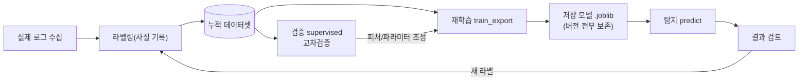
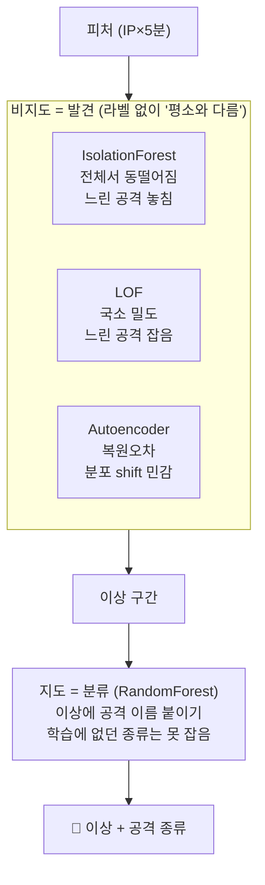
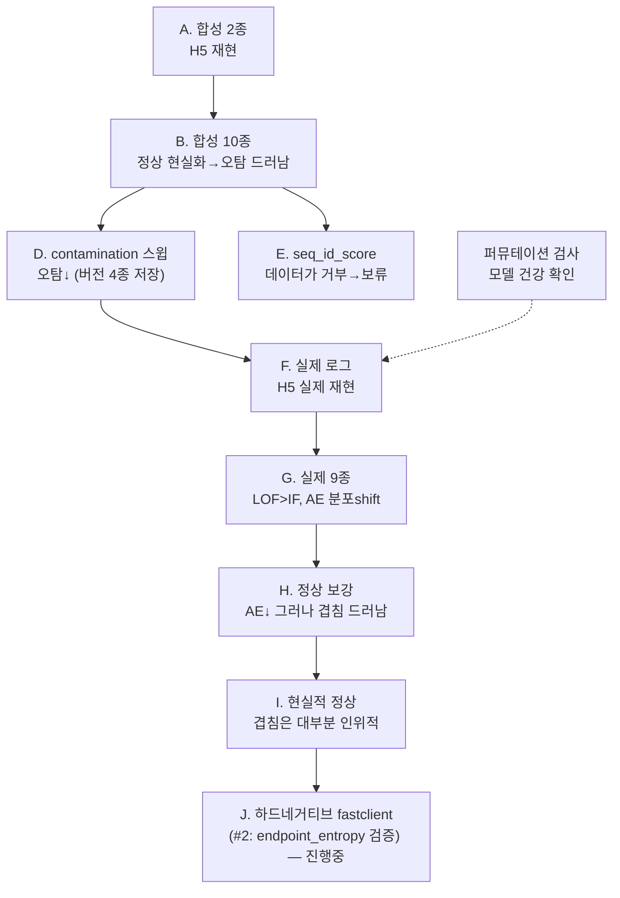

# 23. 개념도 모음 — 토폴로지·파이프라인·실험 계보 (복잡할 때 여기부터)

> 글이 길어져 한눈에 안 들어올 때 이 그림들로 구조를 잡는다. 수치·서사는 `docs/21`, 원리는 `docs/19`.
> (GitHub 에서 mermaid 가 그림으로 렌더됨)

---

## 1. 랩 물리 토폴로지 — 무엇이 어디서 도나

> 한 대(타겟)에 IP 별칭을 붙여 **여러 출발지**를 연출 → nginx 가 remote_addr=별칭 으로 **실제 로그** 기록.

---

## 2. 출발지 IP 역할 맵 — 로그의 "출발지"가 곧 라벨 키

> 라벨은 **출발지+시각 교집합**으로만. IP·UA 는 라벨 키일 뿐 **피처로는 안 씀**(누수 방지).

---

## 3. 데이터 파이프라인 — 로그에서 판정까지

---

## 4. 플라이휠 — 데이터를 쌓아 모델을 키운다

> 탐지≠학습. 향상은 "같은 걸 반복"이 아니라 **데이터를 쌓아 재학습**. `fit`은 덮어쓴다(`docs/19` §1).

---

## 5. 2층 모델 — 발견(비지도) + 분류(지도)

> 편향 위험을 **지도 쪽에 가둠**: 발견은 비지도(처음 보는 공격도)·이름만 지도(`docs/19` §6-1).

---

## 6. 실험 계보 A~I — 어떻게 쌓였나

> 합성(쉬움·포화) → 실제(모델별로 갈림) → 튜닝/피처/정상보강 → 하드네거티브. 상세 `docs/21`.

---

## 문서 지도 (어디서 뭘 보나)
| 보고 싶은 것 | 위치 |
|---|---|
| 개념·원리·편향분산·LLM한계 | `docs/19` |
| API 데이터셋 설계 | `docs/20` |
| 실험 수치·서사(A~I) | `docs/21` |
| DB 보안(별도 phase) | `docs/22` |
| **이 개념도** | `docs/23` |
| 초보 용어 | `learn/GLOSSARY.md` |
| 이어가기(현재 상태) | `HANDOFF.md` |
